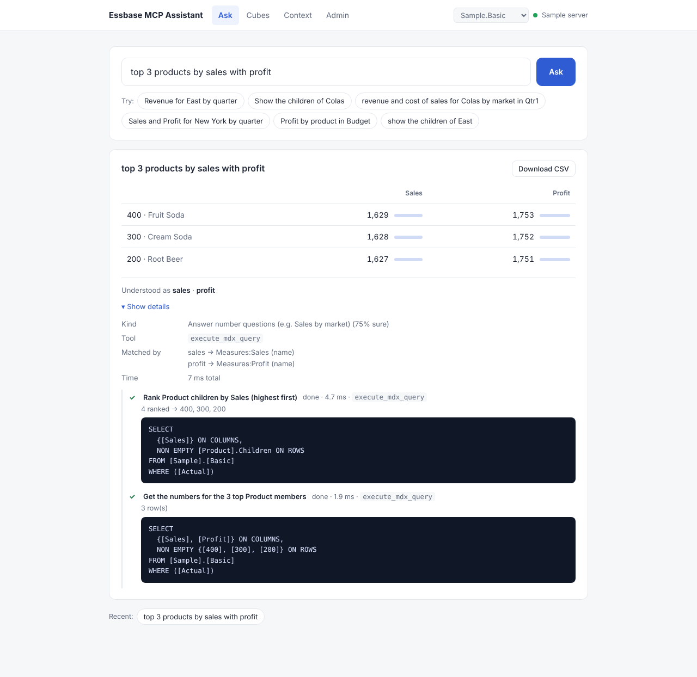
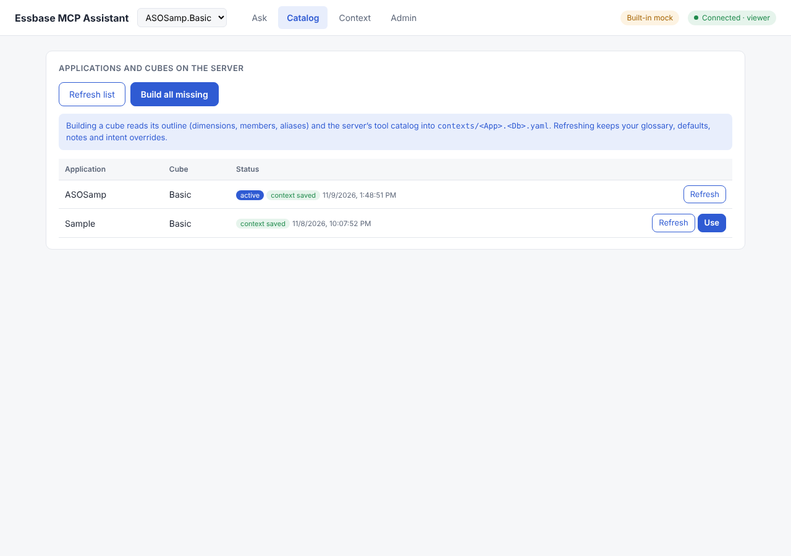
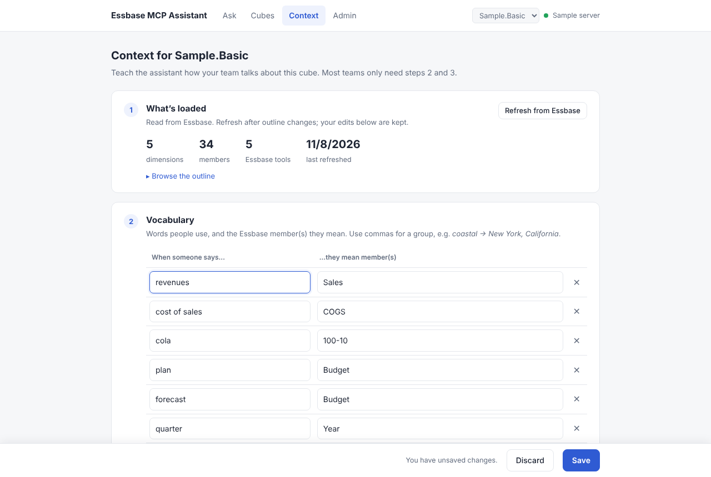

# Essbase MCP Assistant

A reference implementation for asking questions of **Oracle Essbase 26ai** cubes in plain English
through Essbase's built-in **MCP server**. It does three things:

1. **Authenticates** with OAuth 2.1 against an OCI IAM identity domain. Secrets stay server-side and are encrypted at rest.
2. **Understands the question** using a per-cube **context file**: the outline, aliases, a business glossary, defaults and free-form notes. It needs no LLM; any OpenAI-compatible model can be added as an optional hint.
3. **Calls the right MCP tool** with arguments validated against the tool's schema, and shows you exactly what it did.

It runs fully without a live 26ai: a built-in mock server with two sample cubes is the default.
It handles **multi-step questions** (member lookups in large outlines, top/bottom N) and is built
for **many concurrent users** on one shared Essbase connection (tested with 100 at once).
See [docs/CONCURRENCY.md](docs/CONCURRENCY.md).

```
"revenue for coastal markets in plan"
        │  entity linking: names, aliases, glossary   revenue→Sales, coastal→{New York, California}, plan→Budget
        │  intent rules (+ optional LLM hint)          data_query
        │  tool from context.intents                    execute_mdx_query
        ▼  args fitted + validated against inputSchema
SELECT {[Sales]} ON COLUMNS, NON EMPTY {[New York],[California]} ON ROWS
FROM [Sample].[Basic] WHERE ([Budget])
```



## Try it in 2 minutes (no Essbase needed)
```bash
python -m venv .venv && source .venv/bin/activate    # Windows: .venv\Scripts\activate
pip install -e ".[dev]"
emcp web                                             # open http://localhost:8000
```

| Page | For | What you do there |
|---|---|---|
| **Ask** | everyone | Type a question and get a table back. A one-line *Understood as…* shows how your words were read; **Show details** reveals the tool and MDX. |
| **Cubes** | whoever sets it up | **Load** the cubes people can ask about (reads dimensions, members and aliases from Essbase). Switch cubes from the header. |
| **Context** | cube owner | Five short steps: what's loaded, **vocabulary** (your words → members), **assumptions** (e.g. Actual unless stated), business rules, example questions. Tool mapping sits under *Advanced*. |
| **Admin** | administrator | Built-in sample or Essbase 26ai, sign-in, access level, optional AI model. **Test** first, then **Save**; settings persist across restarts. |



## Connecting to a real Essbase 26ai
1. In your OCI IAM identity domain, create a **confidential application** with the client-credentials grant. Note the client ID and secret, and the token URL `https://<domain>.identity.oraclecloud.com/oauth2/v1/token`.
2. Open **Admin**, choose **Essbase 26ai**, and enter the MCP endpoint `https://<host>/essbase/rest/v1/ess-mcp`, the profile, and the OAuth details.
3. Click **Test connection**, then **Save settings**.
4. Open **Cubes** and **Load** the cubes you need. Then check **Context → Advanced: how questions reach Essbase**: tools are matched by name and description, so confirm the right tool is picked for each kind of question.

See [docs/ADMIN.md](docs/ADMIN.md) for how settings and secrets are stored, and how to harden a shared deployment.

## Multi-step questions
| You ask | What happens |
|---|---|
| *Units for Store 117* (not in the cached outline) | find "Store 117" in Essbase → get the numbers. The match is remembered for everyone. |
| *top 3 products by sales with profit* | rank products by Sales → get Sales and Profit for the top 3 |
| *bottom 2 markets by profit by year* | rank markets by Profit → show the bottom 2 by quarter |
| *Units for Store 999* | not found → asks you, rather than returning numbers for the wrong slice |

## Per-user security filters
Switch **Admin → Who Essbase sees** to **Each person signs in**. Everyone then signs in with
their own identity-domain account (authorization code + PKCE), and Essbase applies their own
roles and filters. The same question returns different data for different people, with
`#NoAccess` where a filter hides cells. The built-in sample has three demo users with
different filters. Setup for a real 26ai: [docs/PER_USER_SECURITY.md](docs/PER_USER_SECURITY.md).

**Single sign-on with Microsoft Entra ID.** Choose *Sign-in page → Microsoft Entra ID*, and people
are signed in with their work account automatically, with no page at all if they're already
signed in to Microsoft. Entra ID is federated with the identity domain, so Essbase still gets
identity-domain tokens and applies each person's filters.
See [docs/ENTRA_SSO.md](docs/ENTRA_SSO.md).

## Many users at once
All users share one sign-in, one MCP session and one connection pool. Token refresh and session
recovery happen once, not per user. Parallel Essbase calls are capped, with a queue and a
friendly "busy" message. Each browser picks its own cube, and context edits are conflict-checked.
```bash
python scripts/loadtest.py --users 100 --questions 5
# 100 users x 5 questions = 500 requests ... answered correctly: 500/500, errors 0
```

## Why this design
- **No LLM gateway required.** Rules plus the context file handle common questions deterministically. An LLM can only *suggest* an intent; members and tools are always checked against the context file.
- **Tool names aren't hard-coded.** Tools are discovered via `tools/list` and mapped to intents in the context file, so a different catalog means a rebuild, not a code change.
- **Structured and free-form context.** The glossary and defaults are exact and validated. Notes capture business rules a mapping can't express (see [docs/CONTEXT_FILE.md](docs/CONTEXT_FILE.md)).
- **Server-side secrets.** The browser never sees client secrets or tokens. Saved secrets are encrypted, and state-changing calls need a CSRF header.



## Command line
```bash
emcp apps                                       # applications and cubes on the server
emcp context build --app ASOSamp --db Basic     # save metadata -> contexts/ASOSamp.Basic.yaml
emcp ask "Units by geography" --dry-run         # show the plan only
emcp ask "Units by geography"                   # plan + run
emcp --remote tools                             # force the configured server for one command
pytest                                          # 49 tests, all against the mock
python scripts/loadtest.py --users 100           # against a running `emcp web`
```

## Layout
```
src/essbase_mcp/
  config.py, settings_store.py   settings (defaults < .env < Admin tab), encrypted secrets
  runtime.py                     mock vs. remote connection (pool + call limits)
  auth/       token providers, PKCE, per-user sign-in sessions
  mcp/        JSON-RPC 2.0 / Streamable HTTP client (JSON + SSE, session id, 401 retry)
  context/    builder, argument fitting, per-cube store, shared cache with revisions
  planner/    entity linker, intent rules, MDX builder, multi-step planner + executor
  llm/        optional OpenAI-compatible intent hint (gets glossary + notes)
  mock/       mock identity domain (+ mock Entra ID federation) + Essbase MCP: Sample.Basic, ASOSamp.Basic
  web/        FastAPI backend-for-frontend + single-page UI (no Node build)
contexts/     context files (one per cube)
data/         saved settings + encryption key (git-ignored)
docs/         ARCHITECTURE, CONTEXT_FILE, CONCURRENCY, PER_USER_SECURITY, ENTRA_SSO, ADMIN, ROADMAP
scripts/      loadtest.py
```

## Status
Tested against the mock only. The mock's tool names are placeholders until they're checked against a live 26ai catalog; see [docs/ROADMAP.md](docs/ROADMAP.md). Contributions and reports from real 26ai environments are welcome.

MIT licensed.
