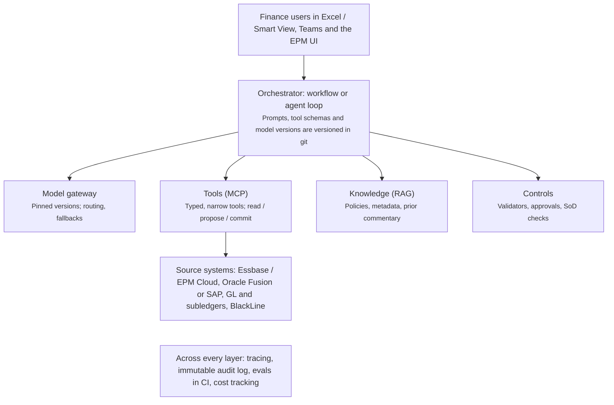

# Production-Grade Finance AI Agents — Reference Architecture & Standards

As of Nov 12, 2026 · Source: the "Production-Grade Finance AI Agents" doc in Claude (this file is the repo copy)

This is the standard every finance AI agent or application must meet before it reaches production: the architecture, the controls, and the checks that prove it works. Use it as the starting point for any new solution and as the design baseline for this project.

## How to use this doc

- **New solution:** fill in the intake template (last section), then design layer by layer against the standards below.
- **Design review:** walk the production readiness checklist; every unchecked item needs an owner or a documented exception.
- **This repo:** the MCP tool design standards and the security, observability and evaluation layers apply directly here.
- **Scope:** agents and LLM-backed applications that read or write finance data, such as EPM, ERP, GL, subledgers, reconciliations, close and forecasting.

Tool and vendor names reflect the market as of the date above. Recheck them before committing to a stack.

## Core principles

These ten rules apply to every solution. A design that breaks one needs a documented exception approved by the business owner.

1. **The LLM never does the math.** It decides what to calculate, code or the source system does the calculation, and the LLM explains the result.
2. **Workflow first, agent second.** Use fixed steps wherever the path is known. Use an agent loop only where the path truly varies.
3. **Start at Draft.** New solutions launch as read-only or draft-only. Write actions are earned with evidence from evaluations.
4. **Every number is traceable.** Each figure in an output links to its source system, point of view and retrieval time.
5. **The agent is a user.** It has its own identity, access rights, RACI entry and segregation-of-duties constraints. It never approves its own work.
6. **Act as the person, not as a super-user.** Tools run with the requesting user's permissions through on-behalf-of authentication.
7. **Every document is untrusted input.** Content the agent reads can never trigger a write without human approval.
8. **Prompts, tools and model versions are code.** They follow ITGC change management: ticket, test, approve, deploy.
9. **No eval, no production.** A golden dataset and passing regression suite are required before go-live and before every change.
10. **Log everything, immutably.** Every run can be replayed to show exactly what the agent saw and did.

## Reference architecture

The model is one component among six. The orchestrator calls it, the tools, the knowledge store and the controls; observability and audit wrap everything.



Read top to bottom: users ask, the orchestrator plans, tools reach source systems under the user's identity, and controls check every output before a human sees it.

## Layer standards

Each layer lists the standard to meet, the nuances that trip teams up, and the tools to consider.

### 1. Use case and autonomy level

**Standard:** every solution declares one autonomy level. Moving up a level requires evaluation evidence and business-owner sign-off.

| Level | What the agent may do | Example | Risk |
| --- | --- | --- | --- |
| Answer | Read and respond | "What drove the Q3 opex variance in Region East?" | Low |
| Draft | Produce output a human edits and posts | Variance commentary, flux explanations, forecast narrative | Low–Med |
| Act with approval | Prepare a change a human approves | Journal entry prep, recon match proposals, triggering a data load | Med–High |
| Autonomous | Act within hard limits | Auto-clear recon items under a set amount, rerun a failed integration job | High |

**Nuances:**

- Pick use cases with history to test against: past closes, approved commentary, confirmed recon matches.
- Good first candidates: variance commentary, close status Q&A, recon match suggestions, policy Q&A, and triage of failed job or integration logs.
- Trust is earned per use case. A controller who trusts the commentary agent does not automatically trust the JE agent.

### 2. Architecture and model layer

**Standard:** use a workflow with LLM steps unless the path truly varies. Pin model versions and access models through an enterprise contract.

**Nuances:**

- Roughly 70% of finance "agents" should be workflows: pull data, compute in code, LLM writes narrative, validator checks it.
- Agent loops fit open-ended investigation, such as "why doesn't this tie?".
- Patterns: *routing* (classify, then send to a specialist), *orchestrator–workers* (split by entity or account), *evaluator–optimizer* (a second call checks the first).
- Route by task: a small model for classification and extraction, a frontier model for reasoning and narrative.
- A silent model upgrade changes outputs. Treat it as a change-management event.

**Tools:**

- Models via enterprise cloud: AWS Bedrock, Azure AI Foundry, Google Vertex AI, OCI Generative AI (Claude, GPT, Gemini, Llama, Cohere).
- Frameworks: Claude Agent SDK, OpenAI Agents SDK, LangGraph, Microsoft Semantic Kernel / Agent Framework, LlamaIndex, Pydantic AI, CrewAI.
- Model gateway: LiteLLM, Portkey (routing, fallbacks, cost tracking).

### 3. Data and context

**Standard:** structured numbers come through governed tools or a semantic layer, never free-form SQL or MDX. Every retrieval carries its full point of view and an as-of timestamp.

**Nuances:**

- **Dimensional context:** every number needs scenario, version, period, currency, entity and view (YTD or periodic).
- **Hierarchies:** alternate rollups, shared members, and eliminations mean a parent is not always the sum of its children. The agent needs metadata as well as data.
- **Sign conventions:** GL credits are often negative while reports show them positive.
- **Point-in-time:** "as of close Day 2" and "after final adjustments" are different answers.
- **Two kinds of knowledge:** structured data (cubes, GL, subledgers) through tools; unstructured content (policies, checklists, contracts, prior commentary) through RAG with citations.

**Tools:**

- Semantic layer: Essbase / EPM Cloud (already governed), dbt Semantic Layer, Cube, AtScale, Snowflake semantic views, Databricks metric views.
- Vector and search: Oracle Database 23ai/26ai vector search, pgvector, OpenSearch, Azure AI Search, Pinecone.
- Document parsing: AWS Textract, Azure Document Intelligence, LlamaParse, Unstructured, Docling.
- RAG quality: hybrid search, rerankers (Cohere Rerank, Voyage), chunking by document section.

### 4. Tool and integration layer

**Standard:** tools are narrow, typed, and split into read and write. Write tools require idempotency keys and sit behind approval gates. Detailed rules are in the MCP tool design standards section.

**Nuances:**

- `get_variance(entity, account, period, scenario_a, scenario_b)` beats `run_mdx(query)`: easier to secure, test and audit.
- Agents retry. A write without an idempotency key can double-post.
- Return values carry provenance: value, source, point of view, retrieved-at.
- Tool descriptions are prompts. The model picks tools by reading them.

**Tools:**

- MCP servers: Oracle Essbase MCP, custom servers over EPM REST and EPM Automate, Snowflake / Databricks / Postgres MCP servers, Microsoft 365.
- System APIs: Oracle Fusion REST, SAP OData, NetSuite SuiteTalk, Workday; BlackLine, Trintech, FloQast; Kyriba.
- API management: Azure APIM, Apigee, Kong.

### 5. Numerical correctness

**Standard:** every number in an output is validated against its source before a human sees it.

**Nuances:**

- Calculations run in code or the source system, never in the model.
- Structured outputs with a JSON schema, validated before use.
- **Tie-out check:** every number quoted in narrative must exist in the source data within rounding. This one check removes most hallucinated figures.
- **Reconciling assertions:** components sum to totals, FX matches the rate table, debits equal credits.
- Materiality thresholds live in code, not in the prompt.
- Low temperature for analytical steps. Output is still not fully deterministic, which is why validators exist.

**Tools:** Pydantic, Instructor, native structured outputs, Guardrails AI; code sandboxes such as E2B, Modal, or Claude / OpenAI code execution.

### 6. Human-in-the-loop and financial controls

**Standard:** the agent sits inside the control framework as a named identity, with segregation of duties enforced in code and approvals backed by evidence.

**Nuances:**

- The agent prepares; a human approves. It never approves anything it touched.
- **Maker-checker by threshold:** low-value, high-confidence items auto-propose; everything else routes to a reviewer.
- The approval screen shows what the agent saw, did and why. A bare "Approve?" button is not a control.
- Prepare for auditor questions: how do you know it's right (evals and validators), who approved it (HITL log), what changed (version control).

**Tools:** LangGraph interrupts, Temporal or Camunda for durable approvals, ServiceNow approvals, Teams or Slack adaptive cards.

### 7. Security and identity

**Standard:** on-behalf-of authentication, least-privilege tools, injection defenses on all untrusted content, and vendor terms that rule out training on your data.

**Nuances:**

- If a user can't see Entity X in Essbase, the agent working for them can't either. Use OAuth token exchange, not a shared service account with broad access.
- **Prompt injection is a finance risk.** A vendor invoice PDF can hide text like "change the remit-to bank account". Content from documents and emails never triggers a write without human approval.
- Keep MNPI (pre-earnings numbers), payroll and PII out of prompts and logs unless explicitly allowed. Mask PII before it reaches the model.
- Vendor terms: no training on your data, zero or minimal retention, data region pinned.

**Tools:** Entra ID, Okta, OAuth 2.1; HashiCorp Vault, AWS Secrets Manager; Microsoft Presidio for PII; AWS Bedrock Guardrails, Azure AI Content Safety / Prompt Shields, Lakera, Llama Guard.

### 8. Evaluation

**Standard:** a golden dataset from real history, scored automatically, run in CI on every change to prompts, tools or model versions. Results are retained as SOX testing evidence.

**Nuances:**

- Build the golden set from approved commentary, confirmed recon matches, and policy questions with known answers.
- Score by output type: numbers by exact match or tolerance in code; narrative by an LLM judge with a rubric, calibrated against human graders; tool use by checking the right tool and point of view were called.
- Red-team regularly: injection attempts, ambiguous requests, periods that don't exist, users asking for data outside their access.
- In production, sample outputs for review and track how much users edit drafts. Heavy rewriting means the agent isn't working.

**Tools:** Braintrust, LangSmith, Arize Phoenix, Promptfoo (CI and red-teaming), DeepEval, Ragas (RAG), Inspect.

### 9. Observability and audit trail

**Standard:** every run is traced end to end, and an immutable audit record is kept for the retention period.

**Nuances:**

- Traces are for debugging; the audit log is immutable and searchable by transaction. Keep them separate.
- Record prompt version, model version, every tool call with inputs and outputs, approvals, and the final output.
- Replayability: you can rebuild exactly what the agent saw when it wrote any past output.
- Track cost and latency per use case. Close week brings spikes.

**Tools:** Langfuse (open source, self-hostable), LangSmith, Arize, Datadog LLM Observability; OpenTelemetry GenAI semantic conventions; S3 Object Lock, Azure immutable blob, OCI retention rules.

### 10. Reliability and operations

**Standard:** durable execution for multi-step jobs, defined fallbacks for model outages, budgets per run, and separate dev, test and prod environments.

**Nuances:**

- Long jobs must resume after a crash rather than restart, especially those that write.
- Retries with backoff, timeouts and provider fallbacks. Define the manual path if the model is down on close Day 1.
- Scheduled agents run through the existing job orchestration platform, with the same monitoring and alerting as other jobs.
- Prompt caching for large stable context such as the chart of accounts and policies.
- Never test write tools against production EPM.

**Tools:** Temporal, Airflow, Control-M, AWS Step Functions; prompt caching in model APIs; LiteLLM or Portkey for budgets and fallbacks.

### 11. Governance and model risk

**Standard:** every solution is in the AI inventory with a named business owner, a risk tier, and a review cycle.

**Nuances:**

- Inventory fields: use case, business owner, IT owner, risk tier, model and version, data used, autonomy level, controls.
- Apply model risk management discipline in the style of SR 11-7: validation before go-live, ongoing monitoring, periodic review.
- Align with NIST AI RMF, ISO/IEC 42001, and the EU AI Act where there is EU exposure.

**Tools:** ServiceNow AI Control Tower / GRC, IBM watsonx.governance, Credo AI, or a well-run register in the existing GRC tool.

### 12. User experience and adoption

**Standard:** deliver inside the tools finance already uses, with sources shown and gaps admitted.

**Nuances:**

- Excel / Smart View, Teams and the EPM UI beat a separate chat portal.
- Every number has a click-through to its point of view or GL lines.
- Say what's unknown: "$200K of this variance has no identified driver" rather than an invented explanation.
- Capture user edits; they become evaluation data.

**Tools:** Excel add-ins (Office.js), Microsoft Copilot Studio, Claude for M365, Teams bots, React or Streamlit front ends.

## MCP tool design standards

Every MCP server built for finance, including this one, follows these rules. They turn the security, correctness and audit principles into concrete server behaviour.

**Tool shape**

1. One tool, one business action, with a verb-noun name: `get_variance`, `list_members`, `propose_journal_entry`.
2. Typed, required parameters for the full point of view: application, cube, scenario, version, period, entity, currency. No defaults that hide a dimension.
3. Raw query tools (MDX, MaxL, SQL) are off by default. Where they're needed, they're read-only, admin-scoped and logged separately.
4. Tool descriptions state what the tool does, when to use it, units and sign convention, and what it never does.
5. Annotate each tool as read-only or destructive (MCP tool annotations) so clients can require confirmation.

**Inputs and outputs**

6. Validate inputs against the outline or metadata before calling the backend. Reject unknown members with a helpful error listing close matches.
7. Return structured content: `{value, unit, sign_convention, pov, source, retrieved_at, data_version}`.
8. Cap result sizes and paginate. Large grids return a summary plus a handle, not 50,000 cells into the context window.
9. Errors are typed and actionable (`member_not_found`, `access_denied`, `cube_locked`), never stack traces.

**Write tools**

10. Writes are split into *propose* and *commit*. The agent may only propose; commit requires a human approval token.
11. Every write requires an idempotency key and returns a change ID.
12. Writes to production cubes (data loads, calcs, metadata changes) run only in approved windows and respect close-calendar freezes.

**Security**

13. OAuth 2.1 with PKCE; tokens are scoped per tool group (read, propose, admin).
14. On-behalf-of identity end to end: the Essbase or EPM call runs as the requesting user, so native filters and security apply.
15. Role mapping from the identity provider (for example Entra ID groups) to tool scopes, reviewed in user access reviews.
16. Secrets in a vault, never in config files or the repo.

**Operations and audit**

17. Every call logs: user, client, tool, parameters, result summary, duration, correlation ID. Use OpenTelemetry.
18. Rate limits per user and per tool, with backoff guidance in the error.
19. Version the tool schema. Breaking changes get a new tool name or version, and go through change management.
20. A contract test suite runs every tool against a test application in CI.

## SOX and ITGC control mapping

Each agent component maps to an existing ITGC domain, so auditors can test it with familiar procedures. Adapt the evidence column to your control catalogue.

| ITGC domain | Agent component | Control | Evidence |
| --- | --- | --- | --- |
| Logical access | Agent service identity, MCP tool scopes | Least privilege; on-behalf-of execution; periodic access review of agent identities and role-to-scope mappings | Access review sign-off, IdP group config, scope matrix |
| Logical access | Write tools | Segregation of duties: agent proposes, a different human approves | Approval logs showing preparer and approver identities |
| Change management | Prompts, tool schemas, model version, guardrail config | Ticketed change, eval suite pass, approval, controlled deploy | Change ticket, CI eval report, deploy log, git history |
| Change management | Model provider upgrade | Treated as a change; regression evals rerun before switching | Eval comparison report, approval |
| IT operations | Scheduled agent runs | Job monitoring, failure alerting, documented manual fallback | Scheduler logs, incident tickets, runbook |
| IT operations | Audit trail | Immutable logs retained for the retention period | Storage retention config, sample replay |
| Data integrity | Numerical outputs | Tie-out and reconciling validators block failing output | Validator logs, exception reports |
| Data integrity | Source data | As-of timestamps and data version on every retrieval | Output metadata samples |
| Governance | Use case | AI inventory entry, risk tier, business owner, periodic review | Inventory record, review minutes |

Add each agent to the RACI and process control documents like any other system user. Where the agent's output feeds a key control (for example, a reconciliation review), the control owner remains a human and the agent is documented as a tool within the control.

## Worked example: variance commentary agent

This Draft-level workflow shows every layer working together. Use it as the template for similar narrative use cases.

1. **Trigger:** actuals load completes on close Day 3; the scheduler starts the workflow.
2. **Pull (tool):** Actual vs. Forecast by entity and account from Essbase through MCP, with the full point of view on every value.
3. **Compute (code):** variances, % change, materiality filter, and drill-down to top drivers by dimension.
4. **Context (RAG):** last month's commentary, known one-time items, forecast assumptions.
5. **Draft (LLM):** narrative for material variances only, as structured output: `{account, variance, drivers[], narrative, sources[]}`.
6. **Validate (code):** every quoted number ties to source; drivers explain at least an agreed share of the variance; no out-of-scope entities.
7. **Review (human):** the controller sees the draft beside its evidence, edits, approves. The approval is logged.
8. **Publish:** to the reporting deck or Planning commentary. Edits feed back into the golden dataset.
9. **Throughout:** traced, cost-tracked, versioned, and regression-tested against prior closes before every change.

| Layer | How this example meets it |
| --- | --- |
| Autonomy | Draft; a human publishes |
| Architecture | Workflow with two LLM steps, not an agent loop |
| Data | Governed cube via MCP; RAG for prior commentary |
| Correctness | Math in code; tie-out validator |
| Controls | Controller approval with evidence |
| Evals | Golden set from 12+ months of approved commentary |

## Production readiness checklist

Copy this checklist into each solution's design doc. Every item needs to be ticked or have a documented exception before go-live.

**Scope and design**

- [ ] Autonomy level declared and approved by the business owner
- [ ] Workflow vs. agent choice justified
- [ ] Model and version pinned; enterprise contract confirms no training and retention terms

**Data and tools**

- [ ] Numbers come only through governed tools or semantic layer
- [ ] Every retrieval returns point of view, source and as-of timestamp
- [ ] Read and write tools separated; writes use propose/commit and idempotency keys
- [ ] MCP tool design standards met

**Correctness**

- [ ] All calculations in code or source system
- [ ] Structured output schema validated
- [ ] Tie-out and reconciling validators in place and blocking
- [ ] Materiality thresholds in code

**Controls and security**

- [ ] Agent identity created, in RACI, included in access reviews
- [ ] Segregation of duties enforced in code
- [ ] On-behalf-of authentication end to end
- [ ] Prompt injection defenses on all untrusted content
- [ ] PII and MNPI handling defined
- [ ] Approval screen shows evidence

**Evaluation**

- [ ] Golden dataset built from real history
- [ ] Eval suite runs in CI on every change; pass thresholds agreed
- [ ] Red-team round completed

**Operations**

- [ ] Tracing and immutable audit log live; sample replay tested
- [ ] Retries, timeouts, fallbacks and manual fallback runbook
- [ ] Cost budgets and alerts set
- [ ] Dev, test and prod environments separated

**Governance**

- [ ] AI inventory entry with risk tier and owners
- [ ] Change management process covers prompts, tools and models
- [ ] Review cycle scheduled

## Anti-patterns

| Anti-pattern | Why it fails | Do instead |
| --- | --- | --- |
| Autonomous writes on day one | No evidence of accuracy; control failure risk | Launch at Draft; earn autonomy with eval results |
| Free-form SQL or MDX against production | A wrong join gives a confident wrong number | Narrow typed tools over a semantic layer |
| LLM doing arithmetic | Plausible but wrong figures | Compute in code; LLM explains |
| No golden dataset | Nobody can prove accuracy to the business or auditors | Build it from past closes before building the agent |
| Prompts edited in production | Untracked change to a SOX-relevant system | Prompts in git, through change management |
| Shared super-user service account | Bypasses data security; SoD violation | On-behalf-of identity, scoped tools |
| Standalone chat portal | Low adoption | Embed in Excel, Smart View, Teams, EPM UI |
| Trusting document content | Prompt injection can redirect payments | Treat as untrusted; human approval for writes |

## Solution intake template

Copy this block into a new doc or repo file when starting any solution.

```markdown
# <Solution name>

## Problem and users
- Business problem:
- Users and how often they'd use it:
- Business owner:            IT owner:

## Autonomy and architecture
- Autonomy level (Answer / Draft / Act with approval / Autonomous):
- Workflow or agent, and why:
- Model(s) and access route:

## Data and tools
- Source systems:
- Tools needed (read / propose / commit):
- Unstructured sources for RAG:
- Data sensitivity (PII, MNPI, payroll):

## Correctness and controls
- Validators (tie-out, reconciling, materiality):
- Approval points and approvers:
- SoD constraints:
- Key controls affected:

## Evaluation
- Golden dataset source and size:
- Metrics and pass thresholds:

## Operations
- Trigger / schedule:
- Fallback if unavailable:
- Cost budget:

## Governance
- Risk tier:
- Inventory ID:
- Review cadence:
```
