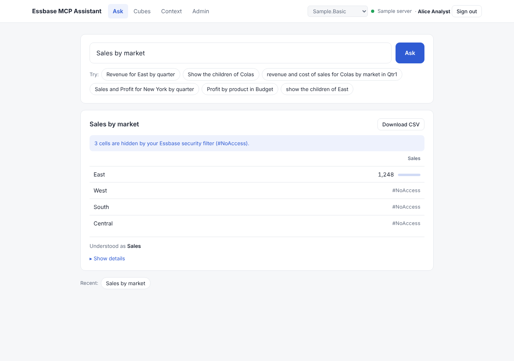
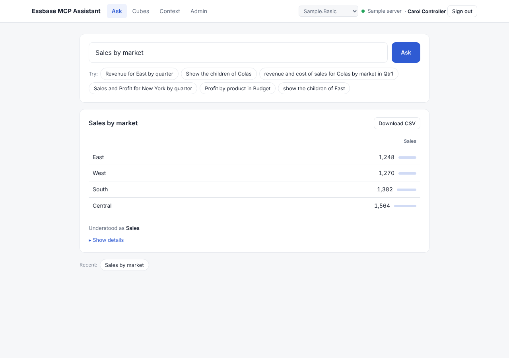

# Per-user security filters

By default the app reaches Essbase with **one service account**, so everyone sees what that
account can see. With **Each person signs in**, every user signs in with their own identity-
domain account. Their own token is sent with their questions, and Essbase applies their
roles and security filters. Two people asking the same question get different answers
(`#NoAccess` where a filter hides data).

```
browser ──/auth/login──► identity domain sign-in (authorization code + PKCE)
   ▲                              │
   │ HttpOnly cookie (session id) │ code
   │                              ▼
 this app ◄──── /auth/callback: code + verifier → access + refresh token (kept server-side)
   │
   │  each user's own token, own MCP session; shared connection pool + call cap
   ▼
Essbase 26ai MCP ── validates the token, runs every tool call as that user
                    → their roles and filters apply
```
Oracle describes the built-in Essbase MCP server this way: the identity domain issues the
token, Essbase validates it, and tool calls run as the signed-in user with existing roles and
filters unchanged ([Oracle blog](https://blogs.oracle.com/autonomous-ai-database/the-built-in-essbase-mcp-server-secure-ai-access-with-oci-iam-oauth)).

## Try it with the built-in sample
1. `emcp web` → **Admin** → *Who Essbase sees* → **Each person signs in** → **Save**.
2. Click **Sign in**. The mock identity domain offers three demo users:

   | User | Filter (read) |
   |---|---|
   | Alice Analyst | `@IDESCENDANTS("East")` on Market / Geography |
   | Bob Buyer | `@IDESCENDANTS("West")` |
   | Carol Controller | everything |

3. Ask *Sales by market* as Alice, then **Sign out** and ask again as Carol.

| Alice (East only) | Carol (all data) |
|---|---|
|  |  |

## Set it up with Essbase 26ai

### 1. Identity domain: one confidential application
OCI Console → Identity & Security → Domains → your domain → **Integrated applications** →
**Add application** → **Confidential Application**.

| Setting | Value |
|---|---|
| Client type | Confidential |
| Allowed grant types | **Authorization code** and **Refresh token**. Add *Client credentials* only if you also want the shared mode or the Admin "Test connection" check |
| Redirect URL | `https://<this app>/auth/callback`. It must match exactly (scheme, host, port, path). For a local trial: `http://127.0.0.1:8000/auth/callback` (allow non-HTTPS URLs on the app) |
| Client authentication | Client secret (the app sends it as `client_secret_post`) |
| Users / groups | If the app enforces grants as authorization, assign the people or groups who may sign in |

**Activate** the application. Note the **client ID**, the **client secret**, and the domain URL.

Scopes: interactive Essbase MCP clients use the IDCS meta-scope `urn:opc:idm:__myscopes__`
(per the Oracle blog above). The app requests `urn:opc:idm:__myscopes__ openid offline_access`
by default:
- `openid` returns an ID token, used only to display the person's name.
- `offline_access` returns a refresh token, so people stay signed in past the access-token
  lifetime (3,600 s by default). Without it, people sign in again every hour.

### 2. Essbase: make sure each person has an Essbase identity with the right filters
Essbase authorizes every call as the signed-in user, so each person (or their group) needs
an Essbase role on the application. Create filters as you normally would, e.g. read on
`@IDESCENDANTS("East")`, and assign them to users or groups.

How identity-domain users map to Essbase users depends on your Essbase security setup;
Oracle's post doesn't spell it out. Confirm that a user can see the application in the
Essbase web UI before testing here.

### 3. This app: Admin page
- **Server** → *Essbase 26ai* → MCP endpoint `https://<essbase-host>/essbase/rest/v1/ess-mcp`.
  Start with **Access level: Viewer**.
- **Who Essbase sees** → *Each person signs in*:
  - *Token URL*: `https://<domain>/oauth2/v1/token`. The authorization URL is derived from it
    (`…/oauth2/v1/authorize`); fill it in only if yours differs.
  - *Client ID* and *Client secret* from step 1.
  - *Redirect URL*: leave blank to use `<this app>/auth/callback`. Set it explicitly if the app
    runs behind a reverse proxy or load balancer, so it matches the registered URL.
  - *Sign-in scope*: keep the default unless your domain needs a resource scope instead.
- **Test connection** checks that both endpoints answer. **Save**, then **Sign in** to finish.

### 4. Run it on HTTPS for anyone but yourself
- Serve the app over HTTPS (a reverse proxy such as nginx, an OCI load balancer, or similar).
  The session cookie is marked `Secure` automatically on HTTPS.
- Behind a proxy, start uvicorn with proxy headers (`--proxy-headers`), or set the
  *Redirect URL* explicitly.
- Set `EMCP_ADMIN_PASSWORD` so only administrators can change settings.

### 5. Verify
Sign in as two people with different filters and ask the same question. **Show details**
shows the identical MDX; only the identity differs, and the data differs.

## What is per person, and what is shared
| | Per person | Shared |
|---|---|---|
| Data values | ✔ enforced by Essbase on each call | |
| Access token, refresh token, MCP session, tool list | ✔ | |
| Connection pool and cap on parallel Essbase calls | | ✔ (protects Essbase) |
| Context files: outline, vocabulary, assumptions | | ✔ loaded with the signed-in user's access, so load cubes as an administrator |
| Member lookups | misses are **not** shared (a member hidden from one person may exist for another) | members found are shared |

**Metadata filters:** the context file holds member names for everyone. If you use filters
that hide **member names** (metadata security), not just data, people could see names they
can't query. Their numbers stay protected by Essbase. If that matters, keep per-team context
files, or don't load those dimensions in full.

**Totals and filters:** a person filtered to East gets `#NoAccess` for questions about the
total Market, because that's the top member. That is Essbase behaving correctly. They should
name a member they can see (*Sales for East by product*).

## Security notes
- Tokens never reach the browser. The browser holds only a random session ID in an `HttpOnly`,
  `SameSite=Lax` cookie.
- PKCE (S256) and a single-use `state` protect the sign-in round trip. A stolen code is useless
  without the verifier, and a forged callback is refused.
- The ID token is read only to show the person's name. Authorization is always Essbase's
  decision on the access token.
- Refresh is single-flight per person. If the identity domain rejects the refresh token (user
  disabled, session revoked), the person is asked to sign in again.
- Sign-out ends the app session, not the identity-domain session.
- Sessions live in memory: restarting the app or changing settings signs everyone out. With
  several app processes, use sticky sessions at the load balancer, or move sessions to a
  shared store such as Redis.

## Troubleshooting
| Symptom | Likely cause |
|---|---|
| Identity domain says the redirect URL is invalid | *Redirect URL* doesn't exactly match the app registration (http vs https, port, trailing slash) |
| "The identity domain refused the sign-in" | Wrong client secret, or *Authorization code* grant not enabled |
| People are asked to sign in every hour | No refresh token: enable the *Refresh token* grant and keep `offline_access` in the scope |
| Signed in, but every question fails | The person has no Essbase role on the application |
| Everything shows `#NoAccess` | The question asks about members outside their filter (often a top-level total) |
